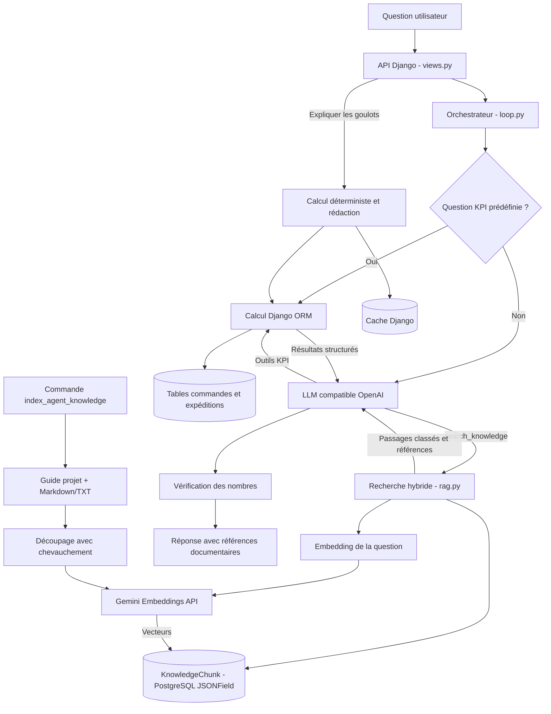

# Architecture de l'agent IA

## Architecture : RAG documentaire et agent SQL hybride

Le projet implémente maintenant un RAG documentaire en complément des outils d'analyse SQL. Le RAG répond aux questions de définitions, de règles et de contexte à partir de documents textuels indexés. Les KPI et les chiffres opérationnels restent calculés par les outils Django, qui sont plus adaptés aux agrégations et aux filtres exacts.

Le corpus d'amorçage comprend `GUIDE_COMPRENDRE_LE_PROJET.md`. Des documents métier Markdown ou TXT peuvent être ajoutés dans `data/knowledge_base/` ou dans le dossier défini par `RAG_DOCUMENTS_DIR`. Gemini Embeddings est utilisé indépendamment du fournisseur de génération de réponses.

## Vue d'ensemble

## Parcours du chat

1. `ChatView` valide la question et l'historique puis appelle `run_agent`.
2. `loop.py` vérifie d'abord si la question correspond à une suggestion courante : taux global de retard, classement des modes d'expédition ou analyse de goulots. Dans ce cas, le backend calcule directement la réponse sans appel au LLM (`source: data`).
3. Pour une question libre, l'orchestrateur transmet au LLM le prompt système, les derniers échanges et les outils autorisés (`tools.py`). `search_knowledge` n'est proposé que si `LLM_BASE_URL` et `RAG_EMBEDDING_MODEL` sont configurés.
4. Pour une question documentaire, le modèle appelle `search_knowledge`. La question est vectorisée par le fournisseur configuré ; `rag.py` classe les passages par similarité cosinus et recouvrement lexical, puis renvoie les meilleurs extraits avec une référence stable.
5. Pour une question chiffrée, le modèle appelle les outils KPI. Ceux-ci appliquent les filtres autorisés et interrogent les modèles Django ; il n'existe pas d'outil SQL libre. Une question mixte peut mobiliser la recherche documentaire et les KPI.
6. Les extraits et résultats chiffrés sont renvoyés au modèle. Le prompt demande de citer les références documentaires sous la forme `[source#chunk-N]`, et les nombres de la réponse sont vérifiés par rapport aux preuves fournies.
7. Les références retrouvées sont renvoyées dans `sources` et affichées sous la réponse dans le chat. Si le LLM échoue ou produit des nombres non étayés après une nouvelle tentative, l'agent retourne une réponse de secours.

### Indexation du corpus

Depuis `backend_supply-chain/`, lancer `python manage.py index_agent_knowledge`. La commande lit le guide et les fichiers `.md`/`.txt` du dossier de connaissances, découpe les documents en passages d'environ 1 200 caractères avec chevauchement, calcule les embeddings par lots puis remplace l'index dans une transaction. Les passages inchangés réutilisent leurs vecteurs ; modifier `RAG_EMBEDDING_MODEL` invalide automatiquement les anciens vecteurs.

Les vecteurs sont conservés en `JSONField` dans PostgreSQL et comparés côté Django. Cette solution évite une extension PostgreSQL ou une nouvelle dépendance et convient au corpus documentaire de taille modeste prévu ici. Pour plusieurs centaines de milliers de passages, il faudra migrer vers `pgvector` ou un moteur vectoriel dédié.

Les outils actuellement déclarés sont `kpi_summary`, `timeseries`, `bottlenecks` et `analyse_goulots`. Leurs calculs portent notamment sur le volume d'expéditions, les retards, les taux, les regroupements région/mode et les délais moyens.

## Parcours « Expliquer les goulots »

Ce parcours est distinct du chat et ne repose pas sur une recherche documentaire :

1. `BottleneckExplainView` transmet les filtres à `explain_bottlenecks`.
2. `analysis.py` calcule l'évidence depuis la base : statistiques globales, classements par volume et retards en excès, écarts de planification, parts de variabilité et constats.
3. `services.py` envoie cette évidence JSON au LLM avec un prompt qui impose une réponse structurée. Les explications sont contrôlées par `guardrails.py` : champs requis, niveau de confiance et nombres présents dans l'évidence.
4. En cas de réponse invalide ou d'indisponibilité du LLM, `template_bottlenecks` produit une explication déterministe. Les réponses IA valides sont mises en cache, avec une clé liée aux paramètres et au dernier chargement ETL réussi.

## Rôle des principaux fichiers

| Fichier | Responsabilité |
| --- | --- |
| `apps/agent/views.py` | Entrées HTTP du chat et de l'explication des goulots. |
| `apps/agent/loop.py` | Parcours du chat, réponses rapides, appels d'outils, contrôle des nombres et secours. |
| `apps/agent/tools.py` | Schémas des fonctions autorisées, validation des paramètres et exécution des calculs. |
| `apps/agent/analysis.py` | Calcul déterministe des statistiques et de l'évidence des goulots. |
| `apps/agent/rag.py` | Découpage, embedding de requête et classement hybride des passages. |
| `apps/agent/models.py` | Stockage PostgreSQL des passages et de leurs vecteurs. |
| `apps/agent/management/commands/index_agent_knowledge.py` | Ingestion et réindexation du corpus documentaire. |
| `apps/agent/services.py` | Appel LLM dédié aux explications, gestion du cache et génération de secours. |
| `apps/agent/llm_client.py` | Client OpenAI compatible pour le LLM de génération. |
| `apps/agent/embedding_client.py` | Client REST Gemini Embeddings avec authentification `RAG_API_KEY`. |
| `apps/agent/prompts.py` | Consignes métier et formats de réponse attendus. |
| `apps/agent/guardrails.py` | Normalisation, validation et vérification des nombres. |

## Configuration

Dans `.env`, configurer séparément le LLM de génération (`LLM_BASE_URL`, `LLM_API_KEY`, `LLM_MODEL`) et Gemini Embeddings (`RAG_EMBEDDING_MODEL=gemini-embedding-2`, `RAG_API_KEY`). Les deux fournisseurs et clés sont indépendants. `RAG_DOCUMENTS_DIR` est facultatif et vaut par défaut `data/knowledge_base/` ; `RAG_TOP_K` permet d'ajuster le nombre maximal de passages retournés (4 par défaut). Le format des vecteurs suit la documentation [Gemini Embeddings](https://ai.google.dev/gemini-api/docs/embeddings), avec les préfixes `question answering` pour la requête et `title/text` pour les documents.

Après une première indexation, le chat peut répondre aux questions de contexte à partir du guide et des documents ajoutés au corpus. Le RAG n'invente pas de procédures absentes des sources : pour des réponses métier plus complètes, ajouter les procédures, consignes ou documents logistiques approuvés dans le dossier de connaissances, puis relancer l'indexation.